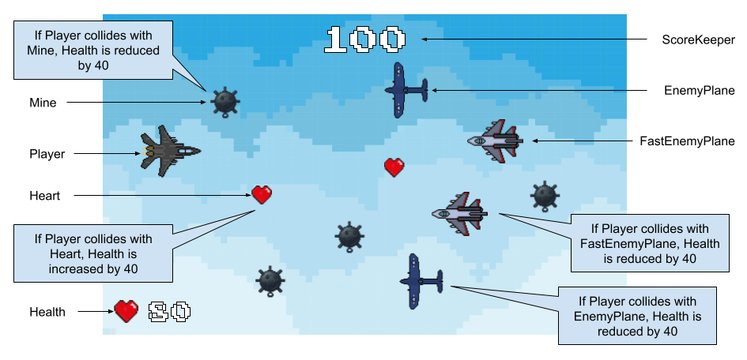

# **Sky Dodgers: Game**

---

# **Brief Description**

In *Sky Dodgers*, you are a solo pilot of a fighter jet during a war. You have been tasked with gathering aerial information about the enemy by flying over their territory. However, you are flying alone and are in danger of hitting hazards like airborne mines and other planes. *Sky Dodgers* has been designed to be a single-player game where the objective is to survive for as long as possible, which translates to getting a score as high as possible. One point is earned for every second the player survives in this hostile battlefield. The plane will move forward without user input; however, the player inputs W or up to move the plane up and S or down to move the plane down. If one desires to use a controller, they can also move the left thumbstick up and down to achieve the same effect. However, the player is limited by a finite health starting at 100%. Crashing into a mine or an enemy plane reduces the player's health by 40%. However, colliding with a floating heart restores the player's health by 20%. The game ends when the player's health reaches 0%.

---

# How to Setup

1. Download the source code to a folder
    1. `git clone https://github.com/codezinx/sky-dodgers-game.git`
2. Enter the `sky-dodgers-game` folder
3. Install dependencies: `pip install -r requirements.txt`
4. Run the game: `python main.py`

---

# The Game Proposal

# **Diagram of Game**

## **Figure 1**

*Diagram of the main game window*  

*Note*. Sprite class names are being used in the diagram. They are explained in more detail below. In addition, excluding the heart in the bottom-left corner, sprites with the same image are copies of the same sprite.

# **Sprite Blueprints**

## **Sprite 1: Player**

### ***Purpose***

The main player sprite of the game. Its purpose is to "move forward," survive, and score as much of a high score as possible. This is the only sprite of the game which is directly controlled by the player. However, in reality, the Player's x-coordinate is not being changed, to give an appearance of the game's camera following the Player.

### ***Attributes***

#### **image**

Responsible for storing the image of a fighter jet representing the player. It is also used to generate the sprite's bounding rectangle. In addition, the background of the fighter jet will be transparent by default, eliminating the need for the unreliable self.image.set\_colorkey(...).

#### **rect**

Responsible for storing the bounding rectangle for the sprite, which is used to determine the spatial position of the sprite, as well as detect collisions with other sprites in the main game loop. The rectangle is created using self.image.get\_rect().

#### **\_\_screen**

Responsible for storing a copy of the screen object. This attribute allows the sprite methods to check whether the Player sprite is within bounds or not.

#### **\_\_dodge\_speed**

A constant attribute which is used to set the maximum vertical movement speed of the plane. Creating a constant attribute allows for an easy change of the dodging speed if needed.

#### **\_\_current\_vy**

A mutable attribute that sets the current vertical movement speed of the plane. It is zero by default, and changes when the user gives input.

#### **\_\_explosion\_sfx**

Stores the sound effect of an explosion that is played when the plane loses all of its health and blows up in the skies.

#### **\_\_freeze**

A boolean value that, if set to True, prevents the Player from moving. It is False by default but set to True when the player blows up and the game is over.

### ***Methods***

#### **\_\_init\_\_(screen)**

This method is responsible for initializing the sprite with the correct attributes given. The screen is passed in, so the program can check whether the player is within bounds.

#### **move(up, ratio)**

Determines the current vertical speed of the plane by setting \_\_current\_vy. The parameter up is a boolean that determines whether the plane will move up or down, and the parameter ratio determines by how much of \_\_dodge\_speed should \_\_current\_vy be set to. \_\_current\_vy is set to \_\_dodge\_speed \* ratio, and made negative if up is True. In addition, \_\_current\_vy is set back to zero if \_\_freeze \== True, to freeze the Player's movement.

#### **blow\_up()**

Responsible for "blowing up" a sprite when called. It works by first freezing or deactivating the sprite (self.\_\_freeze \= True), then changing the image of the sprite to an image of an explosion, playing \_\_explosion\_sfx next, and finally, despawning or hiding the sprite from view. When blow\_up() is called on the player, the game is over.

#### **update()**

Responsible for actually handling plane movement and triggering blow\_up() when the player's health runs out. Whereas move() simply sets \_\_current\_vy and ensures \_\_current\_vy can only be set to non-zero values during a non-frozen state and during user input, update() actually uses \_\_current\_vy to move the sprite up and down. It does this by adding \_\_current\_vy to self.rect.centery. In addition, update() is also responsible for ensuring the plane is unable to move outside the window. 

#### **freeze()**

Sets self.\_\_freeze to True to stop the motion of the Player, in order to take away the ability of the real-life player to move the Player. This will be run when the Player blows up and the game is over, since there is no need for player control when the game is done.

## **Sprite 2: EnemyFrame**

### ***Purpose***

A helper sprite that helps determine the spawn and the movement of enemy sprites, like the Mine and EnemyPlane, discussed after this sprite. It determines the rate the enemy sprites should approach the player, if they are stationary relative to the Earth, and not the player's movement.

### ***Attributes***

#### **image**

Responsible for storing the image of a transparent surface whose dimensions equal the screen's dimensions. It itself does not need to be a visible sprite on the screen, since it is a helper sprite. It also determines this sprite's bounding rectangles.

#### **rect**

Responsible for storing the bounding rectangle for the sprite, which is used to determine the spatial position of the sprite, which will be used in the main game logic to determine when the next EnemyFrame will be spawned. The rectangle is created using self.image.get\_rect().

#### **\_\_screen**

Responsible for storing a copy of the screen object. This attribute allows the sprite to spawn right outside the game window to the right, and approach the player as the player continues to move forward. It will initially be outside the screen, and then come inside the screen.

#### **\_\_speed**

Determines the rate at which the EnemyFrame will approach the Player sprite, which in turn will determine the rate of approach of all enemy sprites, if they are stationary relative to the Earth. It can be thought of as the player's horizontal speed, but since the "game camera" follows the player, it makes more logical sense to move the frame towards the player, rather than move the player towards the frame.

#### **\_\_freeze**

A boolean value that, if set to True, stops the EnemyFrame from approaching the player. This is useful when the game is over, since the Player will blow up and be unable to move.

### ***Methods***

#### **\_\_init\_\_(screen)**

This method is responsible for initializing the sprite with the correct attributes given. The screen is passed in, so that the EnemyFrame can spawn in the right location.

#### **update()**

Responsible for making the EnemyFrame approach the player while the player is alive and moving. In more technical terms, it will keep moving towards the player as long as self.\_\_freeze \== True. The frame will eventually stop moving and despawn once it moves completely out of the window to the left.

#### **get\_speed()**

Returns self.\_\_speed, or the current speed of the EnemyFrame. It is necessary, so that sprites associated with this EnemyFrame are able to move at a minimum of the frame's speed toward the player.

#### **freeze()**

Sets self.\_\_freeze to True to stop the motion of the Frame, in order to represent that the player is no longer moving. This will give the appearance the player stopped moving horizontally.

## **Sprite 3: Mine**

### ***Purpose***

Floats in the skies as a "stationary" object, relative to the Earth. (In reality, it is being moved closer to the player). It acts as an obstacle standing in the player's way and blows up when the Player touches it to inflict damage.

### ***Attributes***

#### **image**

Responsible for storing the image of an air mine. It is also used to generate the sprite's bounding rectangle. In addition, the background of the air mine will be transparent by default, eliminating the need for the unreliable self.image.set\_colorkey(...).

#### **rect**

Responsible for storing the bounding rectangle for the sprite, which is used to determine the spatial position of the sprite, as well as detect collisions with other sprites in the main game loop. The rectangle is created using self.image.get\_rect().

#### **\_\_enemy\_frame**

Responsible for storing the object of the EnemyFrame the sprite is bound to. Allows the program to determine the random spawning of the sprite within the frame's boundaries, and coincide the movement of the sprite towards the player.

#### **\_\_active**

A boolean responsible for determining whether a mine is active and dangerous. It is active when it is in bounds and hasn't blown up. It is True by default.

#### **\_\_explosion\_sfx**

Stores the sound effect of an explosion that is played when the mine blows up in the skies.

### ***Methods***

#### **\_\_init\_\_(enemy\_frame)**

This method is responsible for initializing the sprite with the correct attributes given. The enemy frame is passed in order for proper spawning and movement.

#### **blow\_up()**

Responsible for "blowing up" a sprite when called. It works by first deactivating the sprite (self.\_\_active \= False), so it no longer has an effect on the game, then changing the image of the sprite to an image of an explosion, playing \_\_explosion\_sfx next, and finally, despawning or hiding the sprite from view.

#### **update()**

Responsible for moving the mine sprite from right to left, closer to the player. If the player is able to dodge the mine, it will move past the player. Its movement is determined by the motion of the EnemyFrame it is associated with, since relative to the Earth, it is stationary.

## **Sprite 4: EnemyPlane**

### ***Purpose***

An enemy plane sprite. It is responsible for patrolling your enemy's skies and disrupting your ability to move forward in the game. It takes away the same health as a collision with the mine, but unlike the mine, it actually moves in the skies and approaches the player faster.

### ***Attributes***

#### **image**

Responsible for storing the image of an enemy plane. It is also used to generate the sprite's bounding rectangle. In addition, the background of the air mine will be transparent by default, eliminating the need for the unreliable self.image.set\_colorkey(...).

#### **rect**

Responsible for storing the bounding rectangle for the sprite, which is used to determine the spatial position of the sprite, as well as detect collisions with other sprites in the main game loop. The rectangle is created using self.image.get\_rect().

#### **\_\_enemy\_frame**

Responsible for storing the object of the EnemyFrame the sprite is bound to. Allows the program to determine the random spawning of the sprite within the frame's boundaries, and coincide the movement of the sprite towards the player.

#### **\_\_active**

A boolean responsible for determining whether the plane is active and moving. It is active when it is in bounds and hasn't blown up. It is True by default.

#### **\_\_explosion\_sfx**

Stores the sound effect of an explosion that is played when the plane blows up in the skies.

#### **\_\_speed**

A constant variable that determines how fast the plane should move toward the player, relative to the Earth. From the player's POV, the enemy plane will be moving toward the player faster than the stationary mine.

### ***Methods***

#### **\_\_init\_\_(screen)**

This method is responsible for initializing the sprite with the correct attributes given. The enemy frame is passed in order for proper spawning and movement.

#### **blow\_up()**

Responsible for "blowing up" a sprite when called. It works by first deactivating the sprite (self.\_\_active \= False), so it no longer has an effect on the game, then changing the image of the sprite to an image of an explosion, playing \_\_explosion\_sfx next, and finally, despawning or hiding the sprite from view.

#### **update()**

Responsible for moving the sprite from right to left, closer to the player. If the player is able to dodge this plane, it will move past the player. Its movement is determined by the motion of the EnemyFrame it is associated with, plus \_\_speed, since it is not a stationary sprite. However, \_\_speed will no longer be added to the plane once the plane is inactive.

## **Sprite 5: FastEnemyPlane**

### ***Purpose***

A faster variant of the enemy plane sprite, which inherits from EnemyPlane. Its purpose and the majority of its attributes and methods remain identical to EnemyPlane.

### ***Inherits from***

Sprite: EnemyPlane

### ***Change in Attributes***

#### **image**

The image of FastEnemyPlane will be changed to that of a fighter jet different from the player, to differentiate it from the slower EnemyPlane.

#### **rect**

A bounding rectangle will have to be re-created for FastEnemyPlane, since the image of FastEnemyPlane will most likely not have the same dimensions as EnemyPlane's image.

## **Sprite 6: Heart**

### ***Purpose***

Floats in the skies as a "stationary" object, relative to the Earth. (In reality, it is being moved closer to the player). Unlike the mine, and despite being associated with EnemyFrame, it gives the player health upon contact.

### ***Attributes***

#### **image**

Responsible for storing the image of a heart. It is also used to generate the sprite's bounding rectangle. In addition, the background of the heart will be transparent by default, eliminating the need for the unreliable self.image.set\_colorkey(...).

#### **rect**

Responsible for storing the bounding rectangle for the sprite, which is used to determine the spatial position of the sprite, as well as detect collisions with other sprites in the main game loop. The rectangle is created using self.image.get\_rect().

#### **\_\_enemy\_frame**

Responsible for storing the object of the EnemyFrame the sprite is bound to. Allows the program to determine the random spawning of the sprite within the frame's boundaries, and coincide the movement of the sprite towards the player.

#### **\_\_active**

A boolean responsible for determining whether a heart is active and useful. It is active when it is in bounds and the player hasn't collided with it yet. It is True by default.

### ***Methods***

#### **\_\_init\_\_(enemy\_frame)**

This method is responsible for initializing the sprite with the correct attributes given. The enemy frame is passed in order for proper spawning and movement.

#### **deactivate()**

Responsible for setting \_\_active to False upon being called. This helps prevent the player from healing twice from the same collision.

#### **is\_active()**

Returns self.\_\_active, or whether the heart is active or not, so a different sprite can use it to determine whether the player's health should increase or not.

#### **update()**

Responsible for moving the heart sprite from right to left, closer to the player. If the player misses the heart, it will move past the player. Its movement is determined simply by the motion of the EnemyFrame it is associated with, since relative to the Earth, it is stationary.

## **Sprite 7: ScoreKeeper**

### ***Purpose***

Responsible for determining, keeping track of, and showing the player's current score on screen. Its image is simply a Label showing the current score.

### ***Attributes***

#### **image**

Responsible for storing the image of the rendered score label when the label has been set to the correct value. It is set to the image created by \_\_font.render(...), and it also determines the score label's bounding rectangle.

#### **rect**

Responsible for storing the bounding rectangle for the sprite, which is used to determine the position of the sprite on screen. The rectangle is created using self.image.get\_rect().

#### **\_\_position**

A tuple constant that determines the location of the centre of the score label. It is helpful to reset the position of the score label every time it is updated.

#### **\_\_font**

Determines the font and the font size that will be used to render the score label. It utilizes pygame.font.Font(...) to accomplish this task.

#### **\_\_score**

Determines and keeps track of the player's current score. This is the backbone of the ScoreKeeper sprite's functionality.

### ***Methods***

#### **\_\_init\_\_()**

This method is responsible for initializing the sprite with the correct attributes given.

#### **update()**

Responsible for reading the current score from \_\_score every frame, reupdating self.image with the correct score, then reupdating self.rect with the correct \_\_position.

#### **score()**

When called, score() adds 1 to the current score (self.\_\_score \+= 1). It is supposed to be run for every second after the game starts and until the game is over, so that the score increases by the second of the player's survival.

## **Sprite 8: Health**

### ***Purpose***

Responsible for determining, keeping track of, and showing the player's current health on screen. Its image is a label showing the player's health and a heart to the left of the label.

### ***Attributes***

#### **image**

Responsible for storing the image when an image of a heart and the rendered score label are combined into one Surface object. This new Surface object determines Health's bounding rectangle.

#### **rect**

Responsible for storing the bounding rectangle for the sprite, which is used to determine the position of the sprite on screen. The rectangle is created using self.image.get\_rect().

#### **\_\_position**

A tuple constant that determines the location of the centre of Health. It is helpful to reset the position of Health every time the label is updated to account for the new health.

#### **\_\_font**

Determines the font and the font size that will be used to render the health label. It utilizes pygame.font.Font(...) to accomplish this task.

#### **\_\_heart**

Stores the image of the heart that will be placed beside the health label. It is more beautiful to use an image to represent health rather than using "Health: "

#### **\_\_label**

Stores the rendered label containing the data necessary to show the current player health on screen.

#### **\_\_health**

Determines and keeps track of the player's current health. Health keeps track of the player's health rather than the Player itself. This is the backbone of the Health sprite's functionality.

#### **\_\_heal\_sfx**

Stores the sound effect that will be played when the player gains health from a Heart collision.

### ***Methods***

#### **\_\_init\_\_()**

This method is responsible for initializing the sprite with the correct attributes given.

#### **update()**

Responsible for reading the current health from \_\_health, reupdating \_\_label with the correct health, recombining \_\_label and \_\_health to make the new rendered image for self.image, and finally, reupdating self.rect with the correct \_\_position.

#### **take\_damage()**

When called, this function will reduce the player's health by 40% (self.\_\_health \-= 40). This function will be run when the Player collides with a Mine or an EnemyPlane. This function also ensures the health can never go below 0%.

#### **heal()**

When called, this function will increase the player's health by 20% (self.\_\_health \+= 20). This function will be run when the Player collides with a Heart. This function also ensures the health can never go above 100%. In addition, \_\_heal\_sfx will be played to indicate that the player has gained health.

## **Final Notes**

The attributes and methods may change as necessary, in order to make the game's functionality work. Additional sprites may also be created to add additional functionality of the game. However, the core game mechanic should remain the same.

# **Implementation Steps and Schedule**

The steps are written in second-person, since they are to guide me on what to do:

## **December 8-10: Initialize code and create moving background**

* Set up the IDEA/ALTER framework of the game code  
* Create all necessary files, including a main loop and a sprites file  
* Download and organize all necessary images and fonts needed to run game  
* Download all necessary music and sound effects  
* Ensure game logo is within program files  
* Implement moving background logic from previous assignments  
  * The moving background was implemented in an in-class activity related to space and planets.  
* Moving background will make game appear to "move"  
* Setup pygame.mixer, and write the code to play background music

## **December 11-15: Set up Player object and movement**

* Write the class to set up Player sprite  
* Write code to handle joystick and keyboard input  
* Start creating sprite groups to store the Player, enemy sprites, and on screen information labels  
* Set up Events section of IDEA/ALTER  
* In events section,  
  * Utilize Player's move() object to make Player move  
  * Ensure move() is called again with a ratio of 0 to make the player stop when there is no user input  
* Keyboard and joystick should be able to be used in tandem

## **December 16-17: Create ScoreKeeper, Health, and show them on screen**

* Write all the classes necessary to create these information sprites  
* Make sure appropriate fonts and images are downloaded before creating  
* Implement all necessary methods. They will be used later on in the collision logic.  
* Display these sprites on screen, above all other sprites

## **December 18-20: Create enemy sprites and Heart**

* Ensure appropriate images are downloaded  
* Create the class that will set up the EnemyFrame  
* Write all the classes for the enemy sprites in the sprites Python file  
* Set up the methods and attributes beforehand, so that handling logic becomes easier later on  
* Figure out a way to make the movement of enemy sprites and hearts coincide with the EnemyFrame's movement

## **December 21-26: Set up spawning / despawning of EnemyFrames and their associated sprites**

* Write code that handles the spawning of EnemyFrames  
* ***EnemyFrame spawning logic***  
  * An EnemyFrame will be spawned right outside the screen (to the right)  
  * All the associated sprites like Mines, and EnemyPlanes will be spawned within the boundaries of the EnemyFrame  
  * The EnemyFrame will move across the screen, carrying along its associated objects  
  * When the EnemyFrame is centred on screen, a new EnemyFrame will be spawned and follow the same procedure  
  * When the EnemyFrame goes all the way left outside the screen, it will be despawned, along with the rest of its associated objects  
* Depending on current score, the number of Mines, EnemyPlanes, FastEnemyPlanes, and Hearts spawned will be determined for each frame spawned  
* Difficulty increases with a higher score  
* Spawning logic will continue working as long as player health is above 0

## **December 27 to January 2: Create collision, damage, healing and scoring logic**

* Implement primarily sprite-on-group collisions, since they will allow for the same logic to be reused  
* Implement a clock that resets after every second  
  * After the clock resets, the player's score will increase by 1 by calling ScoreKeeper.score\_one()  
* Implement destruction and damage logic  
  * When Player collides with a Mine and EnemyPlane  
  * The Mine and EnemyPlane must blow\_up()  
  * The explosion must be shown and heard, if class methods have been written properly  
  * Player's health must decrease from this incident  
  * Player will blow\_up() when its health is 0  
* Implement logic to heal player  
  * Detect collision with a Heart  
  * Make Heart inactive upon collision  
  * Run Health.heal() upon collision to give player health  
  * Ensure sound effect is played when healing

## **January 3-5: Implement pausing functionality *(optional feature)***

* Detect a key press (i.e. P) or, better yet, create a pause button that will detect when a user clicks on it.  
* When the user requests the game to be paused, find a way to "freeze" the game and the score in place.  
* Then, overlay another surface that will show "PAUSED" or the Pause icon  
* Ensure there is a way to resume the game: either by a button or by pressing P again  
  * The game should resume from the same state it was paused from  
* This feature may be skipped if time does not allow for

## **January 6-8: Implement a game over screen**

* Design and create the game over screen, including all the necessary labels  
* Find a way to stop all game logic and make it reset from zero  
* Find a way to save the user's score  
* Show user's score on game over screen  
* May also implement saving user's score to a file to save user's high score (high\_score.txt)

## **January 9-12: Implement a main menu *(Optional feature)***

* Ensure the logo of the game is present. It should be placed at the top of the screen.  
* Design labels and drawing that will show controls  
* Design drawings and labels that show the objective of the game, what to avoid (Mine, EnemyPlane, FastEnemyPlane), and how to gain health (Heart)  
* Design a PLAY button that will enter the game when clicked  
* Implement code to show all the main menu elements on screen  
* Play a different background music (less intense) for the main menu  
  * "Lobby music"  
* Ensure main menu doesn't break game functionality

## **January 13-14: Testing**

* Test full game functionality  
* Ensure game code has proper comments and documentation  
* Fix any remaining bugs

## **Closing Notes**

The schedule is a general guideline for when to do which steps to finish the game within the deadline. However, I may work ahead of schedule, or push certain steps behind to accommodate for other tasks.

**References (Image Sources)**  
Elchin ArtsTM. (n.d.). *Pixel Heart*. Vecteezy. https\://www\.vecteezy.com/png/13640968-pixel-heart-pixelart  
Heart (and \_\_heart for Health)  
*Pixel Art Sky Background*. (n.d.). Indonesian-recipes. http\://artpictures.club/view.php?img=https\://static.vecteezy.com/system/resources/previews/023/330/830/original/blue-sky-background-in-pixel-art-style-vector.jpg  
Background image  
*Pixel Art Space Invaders Retro Fighter Jet Design PNG*. (n.d.). PNG ALL. https\://www\.pngall.com/space-invaders-png/download/114439/  
FastEnemyPlane  
retro59. (2022, November 15). *F-15 Fighter Jet*. Dinopixel. https\://dinopixel.com/f-15-fighter-jet-pixel-art-20271  
Player  
yugg0. (n.d.). *Pixel Planes WW2*. itch.io. https\://yugg0.itch.io/pixel-planes-ww2  
		EnemyPlane

* Image of Mine generated using AI  
* *Font used in game and logo:* Press Start 2P from Google Fonts